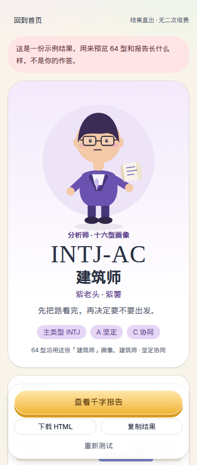
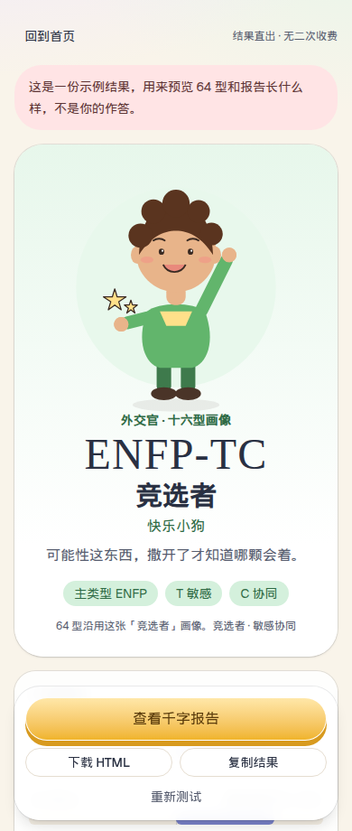
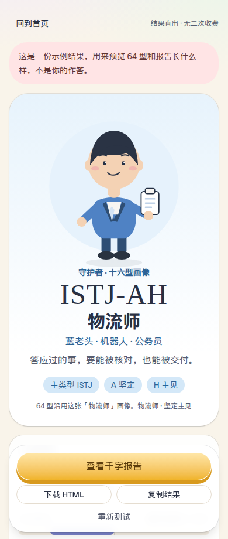
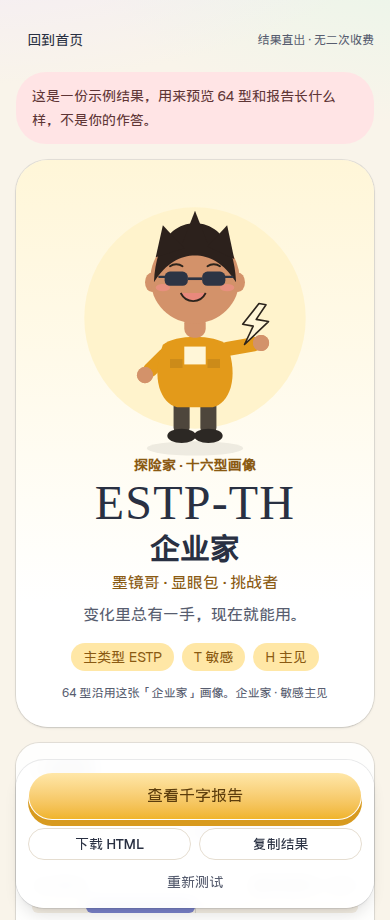

# 64 型人格测试

手机优先的单页人格小测试。108 道 Likert 题覆盖能量（E/I）、关注（N/S）、判断（T/F）、节奏（J/P），以及两层后缀：坚定/敏感（A/T）、协同/主见（C/H）。16 种主类型 × 4 种后缀，答完立刻给出 64 型，并可以带走一千字以上的中文报告。

这是娱乐向的自我观察，不是心理诊断，也不用于招聘。全程没有第二步收费。

## 本地运行

```bash
npm install
npm test
npm run dev
```

开发服务器：<http://127.0.0.1:43123>

## 界面

手机宽度下的开始页，以及四个气质分组的结果页（紫 NT、绿 NF、蓝 SJ、黄 SP）。头像是按十六型新画的扁平几何形象，64 型后缀沿用同一张主类型画像。










生产构建：

```bash
npm run build
npm run preview
```

`dist/` 是静态文件，使用相对路径，可以放在任意静态托管的子目录里。

## GitHub Pages

目标仓库：<https://github.com/zengpenghui420-glitch/mbti-64>

目标地址：<https://zengpenghui420-glitch.github.io/mbti-64/>

静态资源使用相对路径（`base: "./"`），可以放在这个项目站点的子路径下。发布工作流是 `.github/workflows/pages.yml`，在 `main` 被推送时构建并部署。

这个云端环境没有登录 `zengpenghui420-glitch` 的 GitHub 账号，所以仓库需要在本机创建并打开 Pages：

```bash
gh auth login
gh repo create zengpenghui420-glitch/mbti-64 --public --source=. --remote=github --push
gh api --method POST -H "Accept: application/vnd.github+json" \
  /repos/zengpenghui420-glitch/mbti-64/pages \
  -f build_type=workflow
```

如果接口不能单独打开 Pages，在网页上点这几步：

1. 打开 <https://github.com/zengpenghui420-glitch/mbti-64/settings/pages>
2. Build and deployment → Source 选 **GitHub Actions**
3. 打开 Actions 里的 **Deploy GitHub Pages**。如果第一次推送时 Pages 还没打开、工作流失败了，点 **Re-run jobs**。
4. 成功后访问 <https://zengpenghui420-glitch.github.io/mbti-64/>，页面标题应为「64型人格测试 · 结果直出」。

## 可选邀请码

默认开放。若要改成邀请码入口，编辑 `src/config.ts`：

```ts
export const accessConfig = {
  gateEnabled: true,
  inviteCodes: ["OPEN-2026"],
};
```

## 计分

每题 1–5 分，正向题与反向题各半。某一维高于 50% 取 E / N / T / J / A / C，等于或低于 50% 取另一极。刷新页面会从本地记住作答进度。

示例结果（不是你的作答）可以从首页进入，或打开 `#/demo`。
